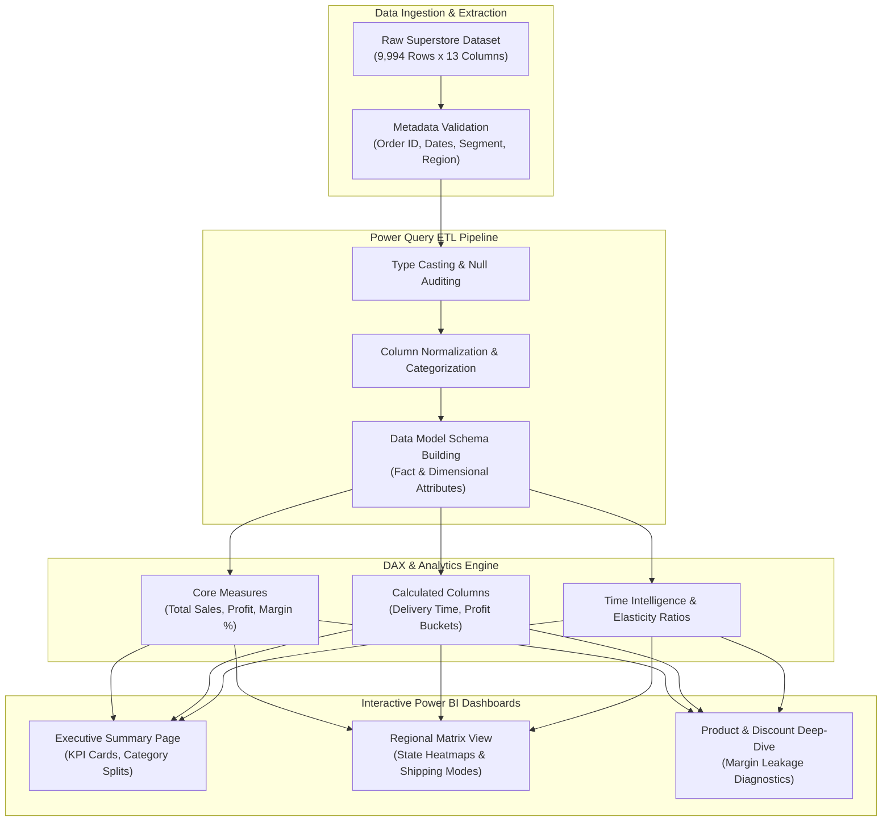

<div align="center">

<a href="https://github.com/akashvenkey/Business-Analytics.3">

</a>


### 🔗 **Project Source Link:** [https://github.com/akashvenkey/Business-Analytics.3](https://github.com/akashvenkey/Business-Analytics.3)

[](https://github.com/akashvenkey/Business-Analytics.3)
[](https://github.com/akashvenkey/Business-Analytics.3.git)

[](https://powerbi.microsoft.com/)
[](https://learn.microsoft.com/en-us/dax/)
[](https://powerquery.microsoft.com/)
[](https://www.kaggle.com/)
[](#)

</div>

---

## 📌 Executive Summary & Overview

Modern retail enterprises manage vast omnichannel transactions where raw transactional logs must be converted into strategic, actionable business intelligence. Without automated KPI metrics and multidimensional slice-and-dice capabilities, business leaders cannot swiftly diagnose margin leaks, regional underperformance, or discount cannibalization.

The **Superstore BI Analytics** repository provides an enterprise-grade business intelligence reporting suite developed in Microsoft Power BI Desktop. Utilizing the benchmark **Sample Superstore** dataset (9,994 transaction records across 13 core dimensions), this project features end-to-end data modeling, ETL data hygiene in Power Query, custom DAX measures, and multi-page interactive executive dashboards. The reports diagnose gross sales performance, segment-wise profitability, geographical shipping velocity, and the direct correlation between promotional discounts and net operating margins.

---

## 📑 Interactive Table of Contents

- [📌 Executive Summary & Overview](#-executive-summary--overview)
- [✨ Key Features & Capabilities](#-key-features--capabilities)
- [📊 Analytical Metrics & DAX KPI Engine](#-analytical-metrics--dax-kpi-engine)
- [🏗 System Architecture & ETL Pipeline](#-system-architecture--etl-pipeline)
- [🛠 Tech Stack Breakdown](#-tech-stack-breakdown)
- [🚀 Reproducible Quickstart & Setup](#-reproducible-quickstart--setup)
- [📂 Project Directory Layout](#-project-directory-layout)
- [👨‍💻 Author & Contributions](#-author--contributions)

---

## ✨ Key Features & Capabilities

- **📈 Executive Sales & Profitability Diagnostics:** Dynamic card visualizers and time-series line charts tracking total revenue, aggregate cost of goods, and net profit margins across fiscal intervals.
- **🗺 Regional & Geographic Decomposition:** Geospatial drill-downs dissecting performance across Central, East, South, and West territories to uncover regional margin discrepancies.
- **👥 Customer Segment Stratification:** Comparative analysis evaluating contribution margins across **Consumer**, **Corporate**, and **Home Office** buyer personas.
- **🏷 Discount vs. Profit Elasticity Analysis:** Scatter-plot distributions and correlation models demonstrating how excessive discounting in specific sub-categories (e.g., Tables, Binders) triggers net negative profit yields.
- **⚡ Interactive Slicers & Tooltip Drillthroughs:** Cross-filtering enabling stakeholders to dynamically isolate results by Order Date, Region, Ship Mode, and Product Category (Technology, Furniture, Office Supplies).

---

## 📊 Analytical Metrics & DAX KPI Engine

The reporting models implement structured Data Analysis Expressions (DAX) to dynamically calculate core business indicators:

| KPI Metric | Conceptual DAX Formulation | Business Interpretation |
| :--- | :--- | :--- |
| **Total Sales** | `SUM(Superstore[Sales])` | Aggregate top-line gross revenue generated across all transactions. |
| **Total Profit** | `SUM(Superstore[Profit])` | Net bottom-line earnings after product costs and recorded expenses. |
| **Profit Margin %** | `DIVIDE([Total Profit], [Total Sales], 0)` | Overall efficiency ratio representing earnings per dollar of gross sales. |
| **Order Volume** | `DISTINCTCOUNT(Superstore[Order ID])` | Total unique orders processed through logistics fulfillment. |
| **Average Discount** | `AVERAGE(Superstore[Discount])` | Mean promotional rate applied across individual order line items. |

---

## 🏗 System Architecture & ETL Pipeline

The following architectural flowchart outlines the end-to-end data transformation from raw CSV to executive dashboard consumption:



---

## 🛠 Tech Stack Breakdown

| Layer | Tools & Technologies | Role in System |
| :--- | :--- | :--- |
| **BI Platform** | Microsoft Power BI Desktop | Data modeling, interactive canvas rendering, and report compilation |
| **ETL Engine** | Power Query (M Language) | Data hygiene, schema validation, type transformation, and column derivation |
| **Formula Language** | DAX (Data Analysis Expressions) | Business logic aggregation, ratio division, and conditional KPI calculations |
| **Data Source** | Sample Superstore Dataset (CSV) | High-volume tabular retail records (Sales, Profit, Quantity, Discount) |
| **Documentation** | Microsoft Word / PDF Reports | Comprehensive experimental methodology, insights, and faculty report submissions |

---

## 🚀 Reproducible Quickstart & Setup

### Prerequisites
- Windows 10/11 Operating System
- **Microsoft Power BI Desktop** (Free download from Microsoft Store or official website)
- Standard PDF Viewer (Adobe Acrobat, Edge, or Chrome)

### Step-by-Step Exploration
```bash
# 1. Clone this repository
git clone https://github.com/akashvenkey/Business-Analytics.3.git

# 2. Navigate to project root
cd Business-Analytics.3

# 3. Open the primary Power BI report file in Power BI Desktop
start "Experiment 2 BI.pbix"
# Or open the first assignment file:
# start "BA Assignment 1.pbix"
```

### Reviewing the Technical Report
For detailed academic problem formulations, step-by-step methodologies, and visual chart interpretations, review `Superstore_Power_BI_Report.docx` or `POWER_BI_ASSIGNMENT.pdf`.

---

## 📂 Project Directory Layout

```plaintext
Business-Analytics.3/
├── BA Assignment 1.pbix            # Primary Power BI workbook for Assignment 1
├── Experiment 2 BI.pbix            # Comprehensive Power BI report for Superstore performance
├── POWER_BI_ASSIGNMENT.pdf         # Formatted academic submission with visual report snapshots
├── Superstore_Power_BI_Report.docx # Detailed technical report documenting methodology and findings
├── README.md                       # Comprehensive documentation and project guide
└── experiment 1/                   # Experiment 1 lab deliverables
    ├── BA Assignment 1.pbix        # Workbook snapshot for experiment 1
    └── sales performance .1.pdf    # Lab documentation on sales performance analysis
```

---

## 👨‍💻 Author & Contributions

**Akash V**  
- **GitHub:** [@akashvenkey](https://github.com/akashvenkey)  
- **Course:** Bachelor of Computer Applications (Hons) — Semester V  
- **Institution:** Department of Computer Application, Alliance University, Bengaluru  
- **Faculty Guide:** Mr. Aman Kumar Sharma  

Questions, feedback, or suggestions regarding DAX optimizations and dashboard usability are always appreciated!

---

<div align="center">

<a href="https://github.com/akashvenkey/Business-Analytics.3">

</a>


### 🔗 **Project Source Link:** [https://github.com/akashvenkey/Business-Analytics.3](https://github.com/akashvenkey/Business-Analytics.3)

[](https://github.com/akashvenkey/Business-Analytics.3)
[](https://github.com/akashvenkey/Business-Analytics.3.git)

</div>